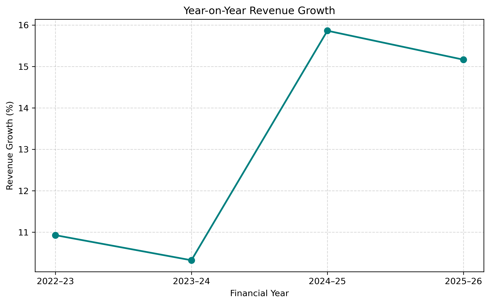
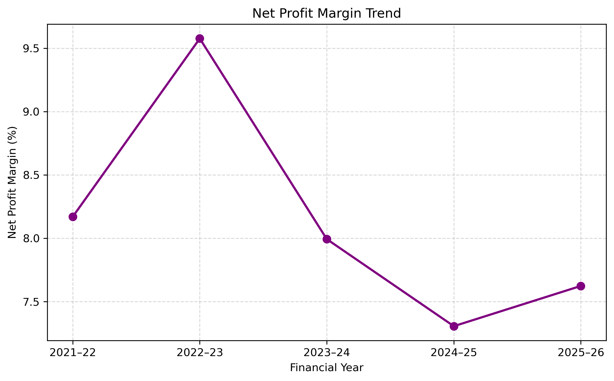
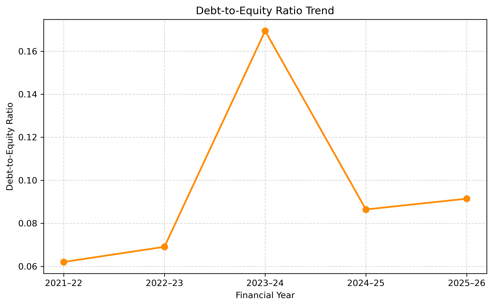
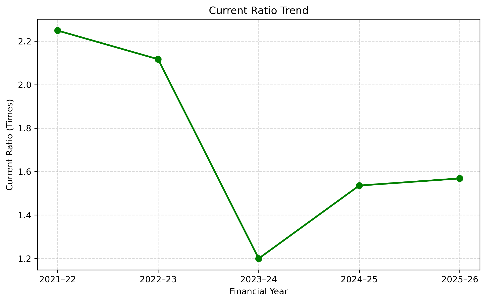
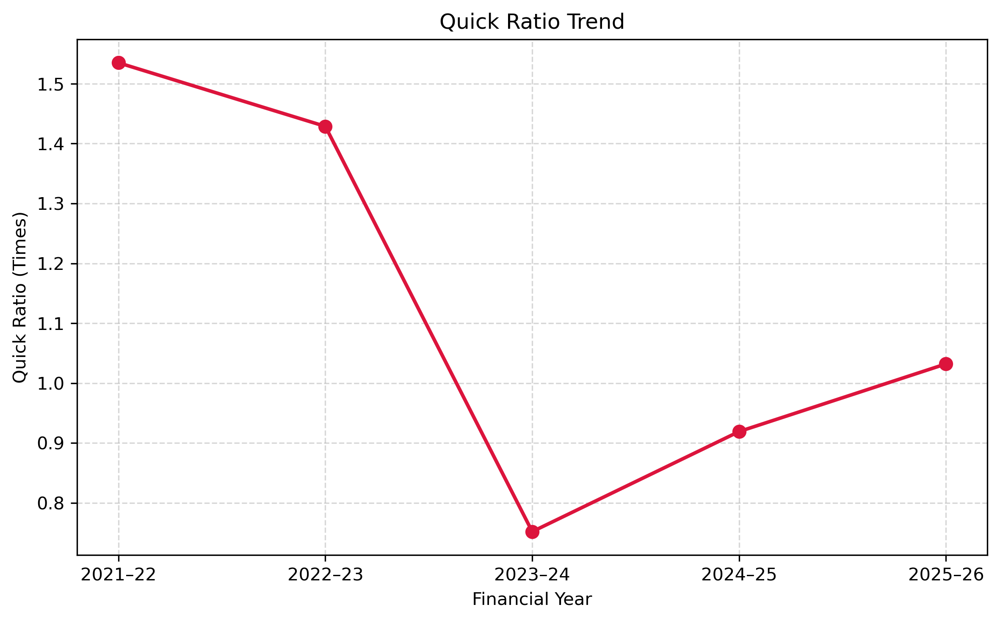
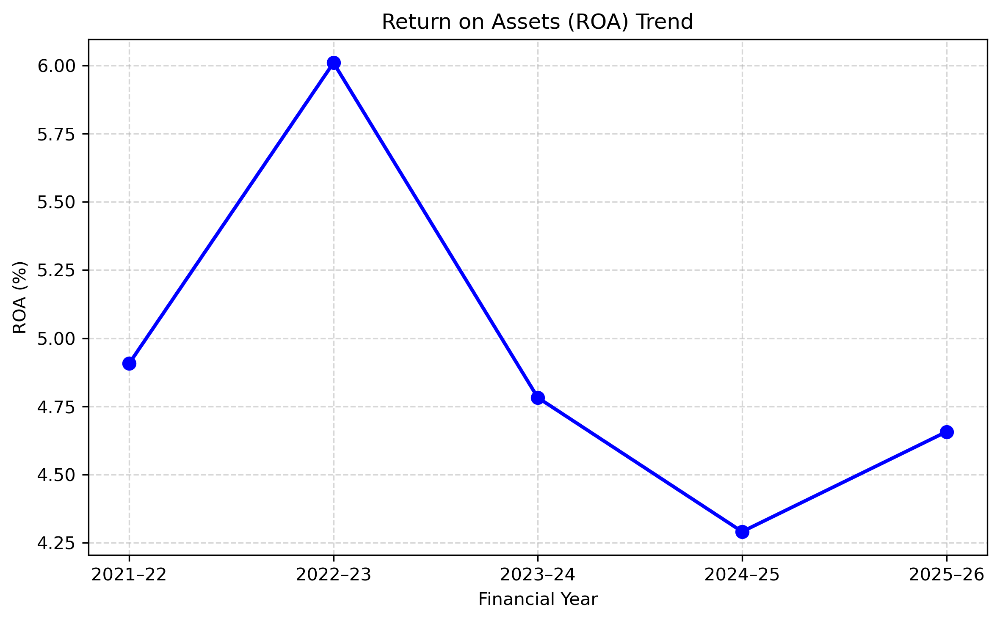
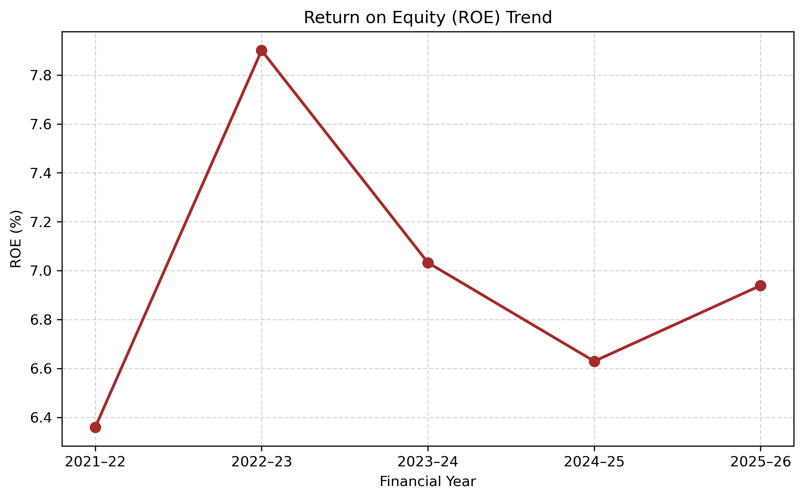
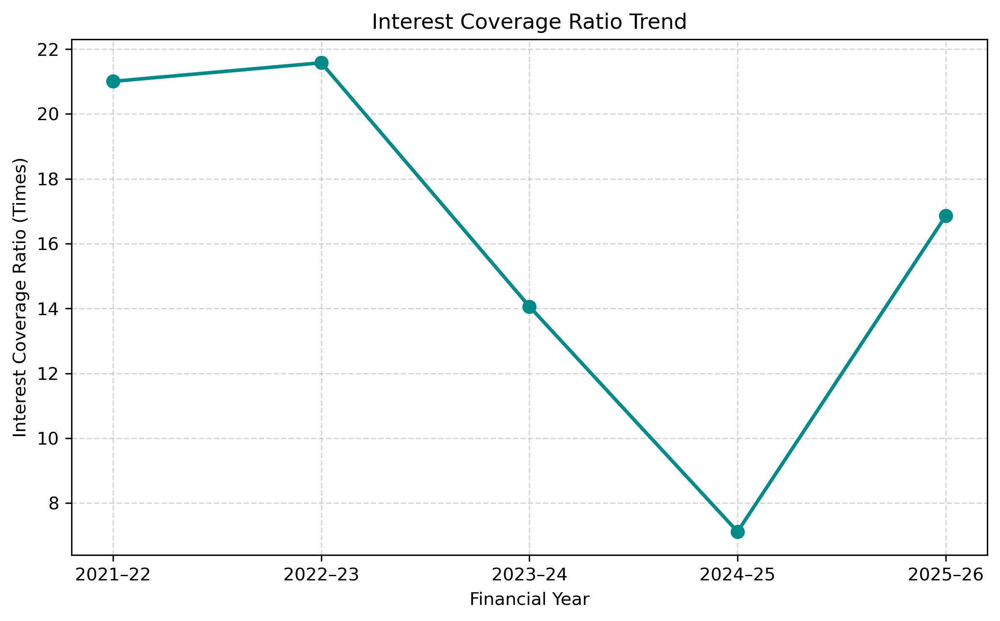
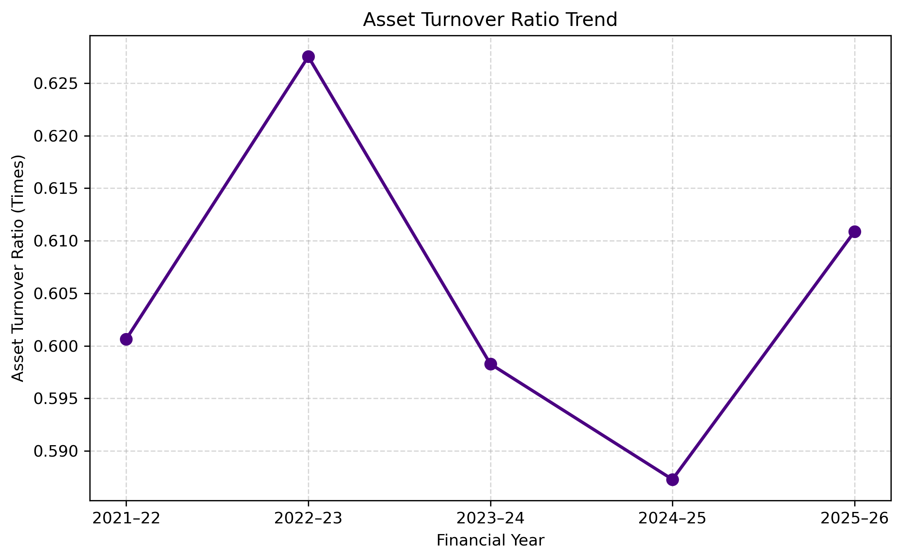

# Financial Performance & Ratio Analysis of Tata Consumer Products Limited

## Project Overview

This project analyzes the financial performance of Tata Consumer Products Limited over five financial years, from FY 2021–22 to FY 2025–26.

Using consolidated financial data, the project evaluates the company's revenue growth, profitability, liquidity, solvency, and operational efficiency through financial ratios and visualizations.

The analysis was performed using Python to calculate financial metrics, identify trends, and present findings through charts.

## Project Objectives

* Analyze the company's financial performance over five financial years.
* Calculate key financial ratios to evaluate profitability, liquidity, solvency, and efficiency.
* Visualize financial trends using Python.
* Identify important financial insights and changes over time.
* Present the analysis in a structured and easy-to-understand format.

## Tools & Technologies

* **Python** — Financial calculations and analysis
* **Pandas** — Data manipulation and analysis
* **NumPy** — Numerical operations
* **Matplotlib** — Data visualization
* **Seaborn** — Statistical data visualization
* **Jupyter Notebook** — Interactive analysis and documentation
* **Microsoft Excel** — Financial data storage and organization

## Financial Ratios Analyzed

| Metric                  | Purpose                                                                  |
| ----------------------- | ------------------------------------------------------------------------ |
| Revenue Growth          | Measures year-on-year revenue growth.                                    |
| Net Profit Margin       | Measures net profit as a percentage of revenue.                          |
| Debt-to-Equity Ratio    | Compares total debt with total equity.                                   |
| Current Ratio           | Evaluates the ability to cover current liabilities using current assets. |
| Quick Ratio             | Evaluates short-term liquidity after excluding inventory.                |
| Return on Assets (ROA)  | Measures profit generated relative to average total assets.              |
| Return on Equity (ROE)  | Measures profit generated relative to average total equity.              |
| Interest Coverage Ratio | Assesses the ability to cover finance costs using estimated EBIT.        |
| Asset Turnover Ratio    | Measures revenue generated relative to average total assets.             |

## Key Insights

* **Revenue Growth:** Revenue increased from ₹12,425.37 crore in FY 2021–22 to ₹20,290.43 crore in FY 2025–26. The highest annual growth rate was 15.87% in FY 2024–25.
* **Profitability:** Net profit margin peaked at 9.58% in FY 2022–23, declined to 7.31% in FY 2024–25, and recovered slightly to 7.62% in FY 2025–26.
* **Debt Management:** The debt-to-equity ratio peaked at 0.17 in FY 2023–24 before declining to 0.09 in FY 2025–26.
* **Liquidity:** The current ratio recovered to 1.57 and the quick ratio to 1.03 in FY 2025–26, indicating an improvement in short-term liquidity.
* **Returns:** ROA and ROE both improved slightly in FY 2025–26 after declining in the previous years.
* **Interest Coverage:** The interest coverage ratio recovered from 7.12 times in FY 2024–25 to 16.86 times in FY 2025–26.
* **Asset Efficiency:** The asset turnover ratio remained relatively stable and reached 0.61 times in FY 2025–26.

## Conclusion

The analysis of Tata Consumer Products Limited from FY 2021–22 to FY 2025–26 shows consistent revenue growth. However, profitability and returns fluctuated throughout the period. Liquidity improved in the latest year, while the debt-to-equity ratio remained relatively low. The recovery in the interest coverage ratio also indicates an improvement in the company's ability to cover finance costs. Overall, the company demonstrated revenue growth and improvement in several financial indicators in FY 2025–26, although profitability and asset efficiency remain important areas to monitor.

## Visualizations

### 1. Revenue Growth



### 2. Net Profit Margin



### 3. Debt-to-Equity Ratio



### 4. Current Ratio



### 5. Quick Ratio



### 6. Return on Assets (ROA)



### 7. Return on Equity (ROE)



### 8. Interest Coverage Ratio



### 9. Asset Turnover Ratio



## Data Source

The financial data used in this project was collected from the official annual reports of Tata Consumer Products Limited for FY 2021–22 to FY 2025–26.

**Official Website:** [Tata Consumer Products — Annual Reports](https://www.tataconsumer.com/investors/investor-information/annual-reports)

The analysis uses consolidated financial statement data, with amounts presented in ₹ crore.

## Project Structure

```text
Financial Performance & Ratio Analysis/
├── Data/
│   └── financial_data.xlsx
├── Notebook/
│   └── financial_analysis.ipynb
├── Images/
│   ├── revenue_growth.png
│   ├── net_profit_margin.png
│   ├── debt_to_equity_ratio.png
│   ├── current_ratio.png
│   ├── quick_ratio.png
│   ├── roa.png
│   ├── roe.png
│   ├── interest_coverage_ratio.png
│   └── asset_turnover_ratio.png
└── README.md
```
## How to Run the Project

1. Clone or download this repository.

2. Install Python and Jupyter Notebook.

3. Install the required Python libraries:

   ```bash
   pip install pandas numpy matplotlib seaborn openpyxl
   ```

4. Open `Notebook/financial_analysis.ipynb` in Jupyter Notebook.

5. Run the notebook cells from top to bottom.

**Note:** Update the Excel file path in the data-loading cell to match the location of `financial_data.xlsx` on your computer.
